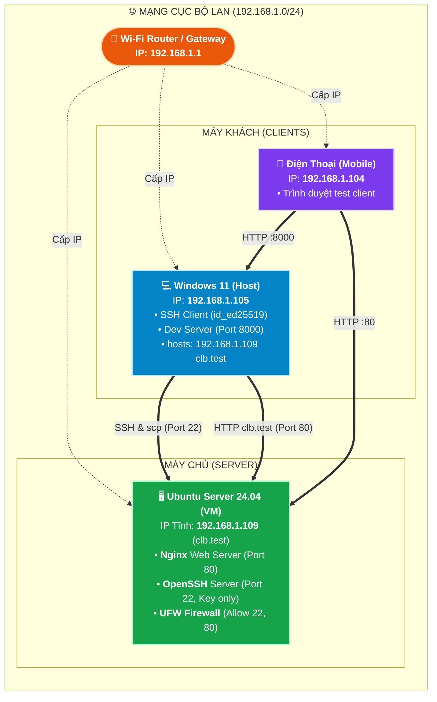

# WEBSITE QUẢN LÝ HOẠT ĐỘNG CÂU LẠC BỘ (CLB-WEB)
## TÀI LIỆU DỰ ÁN & HẠ TẦNG KỸ THUẬT CỦA NHÓM

> **Học phần:** Thực hành Lab 6 tuần (Mô hình Agile Scrum)  
> **Đề cương gốc của Thầy:** Xem chi tiết tại [README.md](file:///e:/FileDuAn/Training_SonVD/haloxlab-training/README.md)  
> **Phiên bản:** Sprint 1 (Tuần 1: Dựng môi trường dự án)

---

## 👥 1. THÀNH VIÊN NHÓM & VAI TRÒ
* **PM (Scrum Master):** @hane
* **Backend Developer:** [Điền tên thành viên]
* **Frontend Developer:** [Điền tên thành viên]
* **Tester / QA:** [Điền tên thành viên]

---

## 🌐 2. SƠ ĐỒ MẠNG DỰ ÁN (NETWORK TOPOLOGY - SPRINT 1)



### Bảng thông số cấu hình mạng Sprint 1:
| Thiết bị / Môi trường | Địa chỉ IP / Tên miền | Cổng (Port) | Dịch vụ & Trách nhiệm | Ghi chú cấu hình / Bảo mật |
| :--- | :--- | :--- | :--- | :--- |
| **Ubuntu Server 24.04 (VM)** | `192.168.1.109`<br/>(`clb.test`) | `80/tcp` (HTTP)<br/>`22/tcp` (SSH) | - **Nginx**: Phục vụ web từ `/var/www/html/`<br/>- **OpenSSH**: Quản trị từ xa bằng SSH key | - Mạng Bridged trong VMware.<br/>- Tắt đăng nhập mật khẩu (`PasswordAuthentication no`).<br/>- Tường lửa UFW chỉ mở cổng `22` và `80`. |
| **Windows Host (Dev)** | `192.168.1.105`<br/>(`localhost`) | `8000/tcp` (HTTP) | - **Dev Server**: `npx serve public -p 8000`<br/>- VS Code, Git, SSH Client | - Windows Firewall mở port `8000` cho mạng Private.<br/>- File `hosts` trỏ `192.168.1.109` -> `clb.test`. |
| **Mobile Client** | `192.168.1.104` | - | - Kiểm thử mở web từ thiết bị thứ 2 trong LAN | - Kết nối cùng mạng Wi-Fi với Windows Host và VM. |
| **Router / Gateway** | `192.168.1.1` | - | - Cấp phát mạng, định tuyến LAN (`192.168.1.0/24`) | - Subnet Mask: `255.255.255.0` (`/24`). |

---

## 🚀 3. HƯỚNG DẪN KHỞI CHẠY & KIỂM THỬ

### 3.1. Chạy thử nghiệm cục bộ trên máy Windows (Dev)
Đứng tại thư mục gốc của dự án (`haloxlab-training`):
```powershell
npx serve public -p 8000
```
Mở trình duyệt truy cập:
* Localhost: `http://localhost:8000`
* Từ điện thoại cùng Wi-Fi: `http://192.168.1.105:8000`

### 3.2. Triển khai lên máy chủ Ubuntu Server (Production)
Dùng lệnh `scp` đẩy mã nguồn giao diện từ Windows sang Ubuntu:
```powershell
scp -r public/* hane@192.168.1.109:/tmp/
ssh hane@192.168.1.109 "sudo cp -r /tmp/index.html /tmp/css /var/www/html/"
```
Mở trình duyệt truy cập:
* Qua tên miền nội bộ: `http://clb.test`
* Qua địa chỉ IP máy ảo: `http://192.168.1.109`

---

## 📂 4. CẤU TRÚC THƯ MỤC DỰ ÁN
```text
haloxlab-training/
├── server/                      # Backend Node.js & API (Tuần 2 & 3)
│   └── routes/                  # Bảng điều hướng API (Tuần 3)
├── public/                      # Frontend web tĩnh (HTML, CSS, JS thuần)
│   ├── css/style.css            # Định kiểu giao diện
│   ├── js/                      # Xử lý logic phía client (Tuần 4)
│   └── index.html               # Trang chủ "Sắp ra mắt"
├── db/                          # Kịch bản CSDL MariaDB (Tuần 2)
├── test/                        # Kiểm thử tự động bằng node:test (Tuần 3 & 5)
├── uploads/                     # Thư mục lưu minh chứng ảnh/PDF (Tuần 5)
├── docs/                        # Tài liệu dự án & Quản lý Scrum
│   ├── debug-log.md             # Nhật ký 5 tình huống săn lỗi mạng
│   ├── bach-khoa-toan-thu-tuan-1.md # Cẩm nang tra cứu lệnh & lỗi
│   ├── Bach_Khoa_Toan_Thu_Thuc_Hanh_Tuan_1.docx # File Word cẩm nang
│   ├── scrum/                   # Biên bản Scrum & Timesheet
│   │   ├── sprint-1.md          # Biên bản Sprint 1
│   │   └── timesheet.md         # Bảng chấm công thực tế
│   ├── man-hinh/                # Phác thảo giao diện (Tuần 2)
│   └── bruno/                   # Bộ test API Bruno (Tuần 3)
├── README.md                    # Đề cương gốc của Thầy
└── README_NHOM.md               # Tài liệu dự án & Kiến trúc của Nhóm
```

---

## 📑 5. TÀI LIỆU THAM KHẢO & LIÊN KẾT NHANH
* [Đề cương chi tiết của Thầy (README.md)](file:///e:/FileDuAn/Training_SonVD/haloxlab-training/README.md)
* [Nhật ký săn lỗi mạng (docs/debug-log.md)](file:///e:/FileDuAn/Training_SonVD/haloxlab-training/docs/debug-log.md)
* [Biên bản Sprint 1 (docs/scrum/sprint-1.md)](file:///e:/FileDuAn/Training_SonVD/haloxlab-training/docs/scrum/sprint-1.md)
* [Bảng theo dõi thời gian thực tế (docs/scrum/timesheet.md)](file:///e:/FileDuAn/Training_SonVD/haloxlab-training/docs/scrum/timesheet.md)
* [Bách khoa toàn thư tuần 1 (docs/bach-khoa-toan-thu-tuan-1.md)](file:///e:/FileDuAn/Training_SonVD/haloxlab-training/docs/bach-khoa-toan-thu-tuan-1.md)
