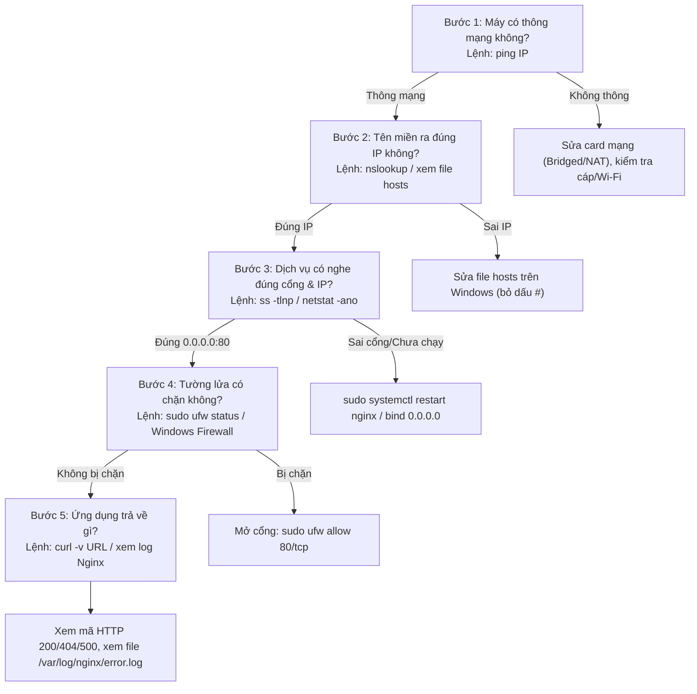

# BÁCH KHOA TOÀN THƯ THỰC HÀNH TUẦN 1
## HẠ TẦNG MẠNG, MÁY CHỦ UBUNTU & MÁY PHÁT TRIỂN WINDOWS

> **Dự án:** Website Quản lý Hoạt động CLB (Agile Scrum 6 Tuần)  
> **Mục tiêu tài liệu:** Tra cứu nhanh mọi câu lệnh, bản chất kiến trúc mạng, nguyên nhân gốc rễ và cẩm nang xử lý mọi sự cố thực chiến.

---

## 📑 MỤC LỤC TRA CỨU NHANH
1. [Phần 1: Mô hình Kiến trúc Mạng & Thông số Hệ thống](#phần-1-mô-hình-kiến-trúc-mạng--thông-số-hệ-thống)
2. [Phần 2: Từ điển Toàn bộ Lệnh Đã Dùng (Windows & Ubuntu)](#phần-2-từ-điển-toàn-bộ-lệnh-đã-dùng-windows--ubuntu)
   - [2.1. Lệnh trên Windows (PowerShell)](#21-nhóm-lệnh-trên-windows-powershell)
   - [2.2. Lệnh trên Ubuntu Server 24.04 (Linux)](#22-nhóm-lệnh-trên-ubuntu-server-2404-linux)
3. [Phần 3: Bách Khoa Toàn Thư Các Lỗi Gặp Phải & Cách Khắc Phục](#phần-3-bách-khoa-toàn-thư-các-lỗi-gặp-phải--cách-khắc-phục)
4. [Phần 4: Quy trình Chuẩn 5 Bước Debug Mạng Của Kỹ Sư](#phần-4-quy-trình-chuẩn-5-bước-debug-mạng-của-kỹ-sư)
5. [Phần 5: Cẩm nang Bảo mật Khóa SSH (Public & Private Key)](#phần-5-cẩm-nang-bảo-mật-khóa-ssh-public--private-key)

---

## PHẦN 1: MÔ HÌNH KIẾN TRÚC MẠNG & THÔNG SỐ HỆ THỐNG

### 1.1. Bảng thông số kỹ thuật 4 thành phần trong mạng LAN
| Thiết bị / Đối tượng | Địa chỉ IP / Tên miền | Cổng (Port) | Dịch vụ hoạt động | Trách nhiệm & Cấu hình |
| :--- | :--- | :--- | :--- | :--- |
| **Router Wi-Fi / Gateway** | `192.168.1.1` | - | DHCP Server, Định tuyến | Cấp dải mạng `192.168.1.0/24`, Subnet Mask `255.255.255.0`. |
| **Ubuntu Server 24.04 (VM)** | `192.168.1.109`<br/>(`clb.test`) | `80/tcp` (HTTP)<br/>`22/tcp` (SSH) | - **Nginx**: Web Server<br/>- **OpenSSH**: Quản trị từ xa | - Card mạng VMware chế độ **Bridged**.<br/>- Thư mục web: `/var/www/html/`.<br/>- Tắt password SSH (`PasswordAuthentication no`).<br/>- Tường lửa UFW mở cổng 22, 80. |
| **Windows 11 Host (Dev)** | `192.168.1.105`<br/>(`localhost`) | `8000/tcp` (HTTP) | - **npx serve**: Dev server<br/>- VS Code, Git, SSH Client | - Máy code chính.<br/>- File `hosts` trỏ `192.168.1.109 clb.test`.<br/>- Windows Firewall mở cổng Inbound 8000. |
| **Điện thoại (Mobile Client)** | `192.168.1.104` | - | Trình duyệt Safari/Chrome | Thiết bị kiểm thử thứ 2 trong LAN; bắt chung Wi-Fi. |

### 1.2. Bản chất chế độ mạng Máy ảo: Bridged vs NAT
* **Chế độ Bridged (Cầu nối) — *Lựa chọn bắt buộc cho Server*:**
  * Biến máy ảo Ubuntu thành một thiết bị vật lý độc lập cắm trực tiếp vào cùng cục Router Wi-Fi.
  * Router cấp IP `192.168.1.109` riêng cho Ubuntu. Windows và Điện thoại đều nhìn thấy và gọi được Ubuntu trực tiếp.
* **Chế độ NAT (Network Address Translation):**
  * Giấu máy ảo vào mạng con riêng biệt phía sau Windows (dải IP lạ như `192.168.182.x`).
  * Máy ảo ra được Internet qua máy Windows, NHƯNG các thiết bị bên ngoài (như điện thoại) **không thể nhìn thấy và không thể truy cập trực tiếp** vào máy ảo.

### 1.3. Cơ chế Tên miền: File hosts vs Máy chủ DNS
* **File `hosts` (`C:\Windows\System32\drivers\etc\hosts`):**  
  Là cuốn "danh bạ cá nhân" nằm ngay trên máy Windows. Khi gõ `http://clb.test`, Windows tra cuốn danh bạ này trước tiên, thấy ghi `192.168.1.109` là kết nối thẳng. Điện thoại không có file này nên không gõ `clb.test` được.
* **Máy chủ DNS (Domain Name System):**  
  Là cuốn danh bạ mạng tập trung. Muốn mọi thiết bị (kể cả điện thoại) đều gõ được tên miền `clb.test` thì phải dùng Local DNS Server (trên Router, Pi-hole) hoặc Public DNS (khi mua tên miền thật ở Tuần 6).

---

## PHẦN 2: TỪ ĐIỂN TOÀN BỘ LỆNH ĐÃ DÙNG (WINDOWS & UBUNTU)

### 2.1. Nhóm lệnh trên Windows (PowerShell)

| Câu lệnh (PowerShell) | Tác dụng & Giải thích kỹ thuật |
| :--- | :--- |
| `ssh-keygen -t ed25519` | Sinh cặp khóa SSH thuật toán Ed25519 siêu an toàn (tạo ra `id_ed25519` và `id_ed25519.pub` tại `~/.ssh/`). |
| `scp -r public/* hane@192.168.1.109:/tmp/` | Sao chép an toàn toàn bộ thư mục `public` từ Windows sang thư mục tạm `/tmp` của Ubuntu qua giao thức SSH. |
| `ssh hane@192.168.1.109` | Mở phiên dòng lệnh điều khiển Ubuntu từ xa bằng SSH key. |
| `ssh -o PubkeyAuthentication=no hane@192.168.1.109` | Thử đăng nhập SSH nhưng ép tắt khóa. Trả về `Permission denied (publickey)` ➔ Chứng minh mật khẩu đã tắt thành công. |
| `npx serve public -p 8000` | Bật web server tĩnh nội bộ từ thư mục `public` trên cổng 8000 của Windows để test code trước khi đẩy lên server. |
| `npx serve -l tcp://0.0.0.0:8000` | Lắng nghe trên TẤT CẢ card mạng của máy, cho phép điện thoại cùng Wi-Fi truy cập qua `192.168.1.105:8000`. |
| `npx serve -l tcp://127.0.0.1:8000` | Chỉ lắng nghe nội bộ trên card Loopback, thiết bị bên ngoài không vào được. |
| `ping 192.168.1.109` | Gửi gói ICMP Echo kiểm tra thông mạng tầng mạng (IP) giữa Windows và Ubuntu. |
| `ping clb.test` hoặc `nslookup clb.test` | Kiểm tra tên miền `clb.test` có được phân giải ra IP `192.168.1.109` qua file hosts hay không. |
| `cd ..` | Di chuyển lùi lại 1 cấp thư mục cha (ví dụ từ `public` lùi về `haloxlab-training`). |
| `cd ../..` | Di chuyển lùi lại 2 cấp thư mục liên tiếp. |
| `netstat -ano \| findstr :8000` | Soi xem cổng 8000 trên Windows có đang được tiến trình nào lắng nghe không và lấy mã PID. |
| `Ctrl + F5` (hoặc `Ctrl + Shift + R`) | Hard Refresh: Ép trình duyệt xóa toàn bộ bộ nhớ đệm (cache) và tải lại phiên bản web mới nhất từ server. |

---

### 2.2. Nhóm lệnh trên Ubuntu Server 24.04 (Linux)

| Câu lệnh (Ubuntu) | Tác dụng & Giải thích kỹ thuật |
| :--- | :--- |
| `ip a` (hoặc `ip addr`) | Hiển thị thông tin tất cả các card mạng (card `ens33`) và địa chỉ IP của máy ảo (`192.168.1.109`). |
| `ss -tlnp` | Liệt kê tất cả các cổng TCP đang lắng nghe (`LISTEN`), địa chỉ bind (`0.0.0.0` hay `127.0.0.1`) và tên tiến trình sở hữu. |
| `sudo systemctl status nginx` | Xem trạng thái Nginx (`active (running)` hay `inactive (dead)`), thời gian chạy từ lúc nào. |
| `sudo systemctl restart nginx` | Khởi động lại toàn bộ Nginx. **Bắt buộc dùng khi đổi cổng listen hoặc sửa VirtualHost để nạp cấu hình mới.** |
| `sudo systemctl reload nginx` | Nạp lại cấu hình mà không ngắt các kết nối người dùng hiện tại (Graceful Reload). |
| `sudo systemctl stop nginx` | Tắt dịch vụ Nginx (dùng để mô phỏng lỗi sập server). |
| `sudo nginx -t` | Kiểm tra cú pháp các file cấu hình Nginx xem có gõ sai dấu chấm phẩy hay sai từ khóa không trước khi reload. |
| `sudo nano /etc/nginx/sites-available/default` | Mở file cấu hình VirtualHost mặc định của Nginx bằng trình soạn thảo nano để cấu hình cổng và đường dẫn web. |
| `sudo ufw status numbered` | Xem trạng thái tường lửa Ubuntu kèm danh sách các luật mạng có đánh số thứ tự (1, 2, 3,...). |
| `sudo ufw allow 80/tcp` | Mở cổng 80 TCP trên tường lửa Ubuntu để client từ bên ngoài có thể truy cập web. |
| `sudo ufw deny 80/tcp` | Chặn cổng 80 TCP trên tường lửa (mô phỏng lỗi Timed Out). |
| `sudo ufw delete <số_thứ_tự>` | Xóa một luật tường lửa theo số thứ tự (ví dụ: `sudo ufw delete 3`). |
| `sudo cp -r /tmp/index.html /tmp/css /var/www/html/` | Sao chép file từ thư mục tạm `/tmp` vào thư mục gốc phục vụ web của Nginx với quyền root. |
| `q` (bấm phím `q`) | Thoát khỏi màn hình xem văn bản dài (pager/less/status) khi terminal bị dừng ở dấu `>` hoặc `:`. |

---

## PHẦN 3: BÁCH KHOA TOÀN THƯ CÁC LỖI GẶP PHẢI & CÁCH KHẮC PHỤC

### 🔴 Lỗi 1: `ERR_CONNECTION_REFUSED` do Nginx bị tắt
* **Hiện tượng:** Mở trình duyệt gõ IP máy ảo lập tức báo lỗi ngay: `This site can’t be reached - 192.168.1.109 refused to connect`.
* **Lệnh phát hiện:** 
  * `ss -tlnp` không thấy xuất hiện cổng `80`.
  * `sudo systemctl status nginx` báo `Active: inactive (dead)`.
* **Nguyên nhân kỹ thuật:** Máy ảo Ubuntu vẫn sống, card mạng nhận gói tin TCP SYN nhưng Hệ điều hành kiểm tra thấy không có tiến trình nào lắng nghe ở cổng 80, nên lập tức gửi trả gói TCP RST (Reset) từ chối kết nối thẳng thừng.
* **Cách khắc phục:** 
  ```bash
  sudo systemctl start nginx
  ```

---

### 🔴 Lỗi 2: `ERR_CONNECTION_REFUSED` do Lệch cổng (Server nghe 8080 nhưng client gọi 80)
* **Hiện tượng:** Nginx đang chạy (`active running`) nhưng trình duyệt gõ `http://192.168.1.109` vẫn bị từ chối kết nối.
* **Lệnh phát hiện:** Chạy `ss -tlnp` thấy dòng `LISTEN 0.0.0.0:8080` (nghe cổng 8080 chứ không phải 80).
* **Nguyên nhân kỹ thuật:** 
  1. Trình duyệt gõ `192.168.1.109` mặc định sẽ gửi vào cổng 80, trong khi server lại đang ngồi chờ ở cổng 8080.
  2. Bạn đã vào `nano` sửa thành `listen 80;` nhưng **quên restart Nginx**, RAM vẫn giữ cấu hình 8080 cũ.
* **Cách khắc phục:** 
  1. Lưu file trong nano (`Ctrl + O` ➔ Enter ➔ `Ctrl + X`).
  2. Kiểm tra cú pháp và khởi động lại:
     ```bash
     sudo nginx -t
     sudo systemctl restart nginx
     ```
  3. Gõ `ss -tlnp` thấy cổng chuyển thành `0.0.0.0:80` là thành công.

---

### 🔴 Lỗi 3: `ERR_CONNECTION_TIMED_OUT` do Tường lửa chặn (UFW / Windows Firewall)
* **Hiện tượng:** Trình duyệt xoay vòng tròn chờ đợi rất lâu (15 - 30 giây), sau đó báo `ERR_CONNECTION_TIMED_OUT`.
* **Lệnh phát hiện:** `ping` vẫn thông, `ss -tlnp` thấy có cổng 80, nhưng chạy `sudo ufw status` thấy cổng 80 bị `DENY` hoặc chưa được `ALLOW`.
* **Nguyên nhân kỹ thuật:** Tường lửa hoạt động theo cơ chế DROP (vứt bỏ gói tin vào sọt rác trong im lặng, không trả lời). Trình duyệt gửi gói tin đi nhưng chờ mãi không thấy hồi âm nên hết hạn kiên nhẫn (Timeout).
* **Cách khắc phục:**
  * **Trên Ubuntu:** Mở cổng qua tường lửa UFW:
    ```bash
    sudo ufw allow 80/tcp
    ```
  * **Trên Windows:** Vào *Windows Defender Firewall with Advanced Security* ➔ *Inbound Rules* ➔ Tạo luật *New Rule...* ➔ Cho phép Port TCP `8000`.

---

### 🔴 Lỗi 4: Máy tính vào được nhưng Điện thoại không vào được (Lỗi Bind 127.0.0.1)
* **Hiện tượng:** Trên máy Windows gõ `localhost:8000` vào được, nhưng lấy điện thoại gõ `192.168.1.105:8000` thì báo lỗi.
* **Lệnh phát hiện:** Kiểm tra lệnh chạy server thấy bind `127.0.0.1` (`npx serve -l tcp://127.0.0.1:8000`).
* **Nguyên nhân kỹ thuật:** `127.0.0.1` là card mạng ảo Loopback nội bộ. Card mạng vật lý Wi-Fi sẽ từ chối/bỏ qua toàn bộ gói tin từ bên ngoài mạng gửi vào địa chỉ này.
* **Cách khắc phục:** Đổi địa chỉ lắng nghe thành `0.0.0.0` (nghe trên tất cả các card mạng):
  ```powershell
  npx serve -l tcp://0.0.0.0:8000
  ```

---

### 🔴 Lỗi 5: Gõ IP vào được nhưng gõ tên miền `clb.test` không vào được (Lỗi File hosts)
* **Hiện tượng:** Gõ `http://192.168.1.109` vào web bình thường, nhưng gõ `http://clb.test` báo không tìm thấy máy chủ DNS. Lệnh `ping clb.test` báo `Ping request could not find host`.
* **Lệnh phát hiện:** Mở file `C:\Windows\System32\drivers\etc\hosts` kiểm tra.
* **Nguyên nhân kỹ thuật:** Dòng cấu hình bị dính dấu thăng `#` ở đầu (`# 192.168.1.109 clb.test`). Dấu `#` biến dòng đó thành chú thích (comment), Windows bỏ qua không phân giải tên miền.
* **Cách khắc phục:** Mở Notepad bằng quyền Administrator, mở file `hosts`, xóa dấu `#` ở đầu dòng và lưu lại:
  ```text
  192.168.1.109    clb.test
  ```

---

### 🔴 Lỗi 6: Sửa code trên Windows nhưng mở web trên Ubuntu không thấy thay đổi
* **Hiện tượng:** Sửa file `index.html` trên Windows (thêm chữ "Bản nội bộ"), lưu file rồi F5 trình duyệt vẫn chỉ thấy trang web cũ.
* **Nguyên nhân kỹ thuật:** Máy tính Windows và máy ảo Ubuntu là **2 hệ điều hành độc lập với 2 ổ cứng riêng biệt**. Sửa file trên ổ cứng Windows thì máy ảo Ubuntu không thể tự biết nếu bạn chưa copy file sang thư mục `/var/www/html` của Nginx.
* **Cách khắc phục:** Dùng lệnh `scp` đẩy file mới sang Ubuntu:
  ```powershell
  scp -r public/* hane@192.168.1.109:/tmp/
  ssh hane@192.168.1.109 "sudo cp -r /tmp/index.html /tmp/css /var/www/html/"
  ```

---

### 🔴 Lỗi 7: Chạy `npx serve public` bị lỗi `404 The requested path could not be found`
* **Hiện tượng:** Chạy lệnh `npx serve public -p 8000` nhưng mở `localhost:8000` thì báo trang trắng lỗi 404.
* **Nguyên nhân kỹ thuật:** Bạn đang đứng sai thư mục!
  * Nếu đứng ở `Training_SonVD`: Ở ngoài đó không có thư mục `public`.
  * Nếu đã gõ `cd haloxlab-training/public`: Bạn đã đứng sẵn trong `public` rồi mà lại gõ `serve public`, nó sẽ đi tìm `public/public` (bị trùng lặp).
* **Cách khắc phục:**
  * Nếu đứng ở thư mục gốc dự án (`haloxlab-training`):  
    ```powershell
    npx serve public -p 8000
    ```
  * Nếu đang đứng sẵn bên trong thư mục `public`:  
    ```powershell
    npx serve . -p 8000
    ```

---

### 🔴 Lỗi 8: Sửa server xong nhưng Chrome vẫn hiện lỗi 404 cũ (Lỗi Cache)
* **Hiện tượng:** Lệnh server đã chạy thành công (trả về mã 200 OK), nhưng tải lại tab Chrome vẫn hiện lỗi 404 hoặc nội dung cũ.
* **Nguyên nhân kỹ thuật:** Trình duyệt Chrome tự động lưu trang lỗi hoặc trang web cũ vào bộ nhớ đệm (Cache) trên ổ cứng máy tính để tăng tốc độ tải, chưa kịp gửi request mới lên server.
* **Cách khắc phục:** Bấm tổ hợp phím **`Ctrl + F5`** (hoặc `Ctrl + Shift + R`) để ép trình duyệt xóa sạch cache và tải lại trang mới.

---

## PHẦN 4: QUY TRÌNH CHUẨN 5 BƯỚC DEBUG MẠNG CỦA KỸ SƯ

Mỗi khi gặp sự cố "không vào được web", hãy tuần tự thực hiện theo 5 bước sau:



---

## PHẦN 5: CẨM NANG BẢO MẬT KHÓA SSH (PUBLIC & PRIVATE KEY)

1. **Khóa riêng (Private Key - `id_ed25519`):**
   * Vị trí: `C:\Users\NITRO\.ssh\id_ed25519` trên máy Windows.
   * Bản chất: Là chiếc **chìa khóa nhà**.
   * Quy tắc vàng: **BẢO MẬT TUYỆT ĐỐI**, không chia sẻ cho bất kỳ ai, không bao giờ đẩy lên GitHub.
2. **Khóa công khai (Public Key - `id_ed25519.pub`):**
   * Vị trí gốc: `C:\Users\NITRO\.ssh\id_ed25519.pub` trên máy Windows.
   * Vị trí lưu trên máy chủ Ubuntu: `~/.ssh/authorized_keys`.
   * Bản chất: Là chiếc **ổ khóa** treo trước cửa nhà. Server dùng ổ khóa này để so khớp khi bạn mở cửa bằng chìa khóa riêng.
3. **Vô hiệu hóa mật khẩu (`PasswordAuthentication no`):**
   * Cấu hình trong: `/etc/ssh/sshd_config` hoặc `/etc/ssh/sshd_config.d/*.conf`.
   * Tác dụng: Ngăn chặn 100% các cuộc tấn công dò quét mật khẩu tự động (Brute-force) từ hacker trên mạng.
