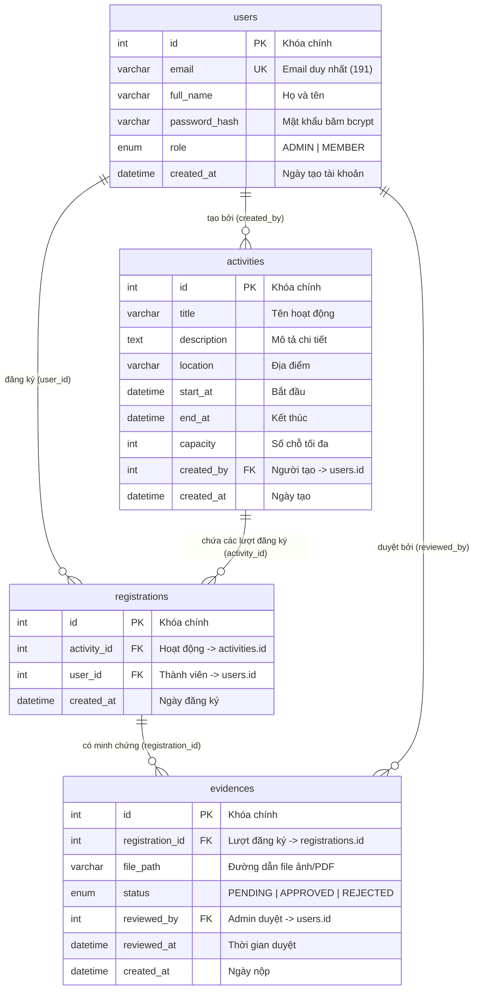

# Hướng dẫn Toàn tập Cú pháp Cơ sở Dữ liệu & Ý nghĩa Thiết kế CSDL (Tuần 2)

> **Dự án:** Hệ thống Quản lý Hoạt động Câu lạc bộ (UHL Active)  
> **Căn cứ:** Đề cương Lab Vũ Duy Sơn (Mục 7, Bước 3 Tuần 2) & Tiêu chuẩn hoàn thành (DoD)  
> **Tài liệu Word đính kèm:** [`docs/Huong_Dan_Cu_Phap_Va_Thiet_Ke_CSDL_Tuan_2.docx`](file:///e:/FileDuAn/Training_SonVD/haloxlab-training/docs/Huong_Dan_Cu_Phap_Va_Thiet_Ke_CSDL_Tuan_2.docx)  
> **Sơ đồ ERD:** [`docs/erd.png`](file:///e:/FileDuAn/Training_SonVD/haloxlab-training/docs/erd.png)

---

## 📑 MỤC LỤC
1. [Chương 1: Tổng quan Kiến trúc CSDL & Sơ đồ Thực thể (ERD)](#chương-1-tổng-quan-kiến-trúc-csdl--sơ-đồ-thực-thể-erd)
2. [Chương 2: Giải phẫu Toàn diện Cú pháp DDL trong db/001_init.sql](#chương-2-giải-phẫu-toàn-diện-cú-pháp-ddl-trong-db001_initsql)
3. [Chương 3: Giải phẫu Cú pháp DML & Chiến lược Seed Dữ liệu Kiểm thử](#chương-3-giải-phẫu-cú-pháp-dml--chiến-lược-seed-dữ-liệu-kiểm-thử)
4. [Chương 4: Hướng dẫn Thực thi trên HeidiSQL & Truy vấn Nghiệm thu](#chương-4-hướng-dẫn-thực-thi-trên-heidisql--truy-vấn-nghiệm-thu)
5. [Chương 5: Bảng Tra cứu Cú pháp SQL Nhanh (Cheatsheet)](#chương-5-bảng-tra-cứu-cú-pháp-sql-nhanh-cheatsheet)

---

## Chương 1: Tổng quan Kiến trúc CSDL & Sơ đồ Thực thể (ERD)

Trong đề cương 6 tuần của thầy Vũ Duy Sơn, nhóm phát triển theo tinh thần **No-Framework**: tự làm chủ các câu lệnh SQL thuần (`raw SQL`), hiểu rõ cấu trúc bảng, kiểu dữ liệu, các ràng buộc toàn vẹn khóa chính, khóa ngoại thay vì phụ thuộc vào các thư viện ORM.

### 1.1. Sơ đồ Thực thể ERD (Mermaid)



### 1.2. Bảng phân tích 4 Thực thể chính

| Tên Bảng | Ý nghĩa Nghiệp vụ | Khóa Chính (PK) / Khóa Ngoại (FK) | Quan hệ trong CSDL |
| :--- | :--- | :--- | :--- |
| **`users`** | Quản lý tài khoản Người dùng: Quản trị viên (`ADMIN`) và Sinh viên (`MEMBER`). | PK: `id`<br>UK: `email` | `1 : N` với `activities`<br>`1 : N` với `registrations`<br>`1 : N` với `evidences` |
| **`activities`** | Quản lý thông tin hoạt động, phong trào của CLB (Tên, địa điểm, sức chứa...). | PK: `id`<br>FK: `created_by → users(id)` | `1 : N` với `registrations`<br>`N : 1` với `users` |
| **`registrations`** | Bảng trung gian ghi nhận lượt đăng ký của thành viên vào từng hoạt động. | PK: `id`<br>FK: `activity_id`, `user_id`<br>UK: `(activity_id, user_id)` | `N : 1` với `activities`<br>`N : 1` với `users`<br>`1 : N` với `evidences` |
| **`evidences`** | Lưu trữ minh chứng tham gia hoạt động (ảnh/PDF) và trạng thái xét duyệt. | PK: `id`<br>FK: `registration_id`<br>FK: `reviewed_by → users(id)` | `N : 1` với `registrations`<br>`N : 1` với `users` (Admin duyệt) |

---

## Chương 2: Giải phẫu Toàn diện Cú pháp DDL trong `db/001_init.sql`

### 2.1. Cụm 1: Quản trị CSDL & Bảng mã Tiếng Việt

```sql
CREATE DATABASE IF NOT EXISTS `clb`
  CHARACTER SET utf8mb4
  COLLATE utf8mb4_unicode_ci;

USE `clb`;
```

* **`CREATE DATABASE IF NOT EXISTS clb`**: Kiểm tra nếu database `clb` chưa có thì tạo mới, nếu đã có thì bỏ qua. Giúp chạy lại script nhiều lần không bị lỗi.
* **`CHARACTER SET utf8mb4`**: Bộ mã hóa 4-byte UTF-8, hỗ trợ 100% tiếng Việt có dấu đầy đủ và các biểu tượng cảm xúc (emoji ⚽, 🩸, 🎉).
* **`COLLATE utf8mb4_unicode_ci`**: Quy tắc so sánh chuỗi theo chuẩn Unicode quốc tế. Đuôi `_ci` (Case-Insensitive) không phân biệt chữ hoa, chữ thường khi tìm kiếm.
* **`USE clb`**: Chuyển ngữ cảnh làm việc hiện tại vào database `clb`.

---

### 2.2. Cụm 2: Dọn dẹp Bảng cũ & Quy tắc Thứ tự Khóa Ngoại

```sql
DROP TABLE IF EXISTS `evidences`;
DROP TABLE IF EXISTS `registrations`;
DROP TABLE IF EXISTS `activities`;
DROP TABLE IF EXISTS `users`;
```

> [!IMPORTANT]
> **Quy tắc vàng:** Trong CSDL quan hệ, bảng con (chứa khóa ngoại) phải bị xóa trước, sau đó mới xóa dần ngược lên bảng cha. Nếu xóa bảng cha trước, MariaDB sẽ chặn lại và báo lỗi vi phạm tính toàn vẹn tham chiếu (*Cannot drop table referenced by a foreign key constraint*).

Thứ tự dọn dẹp bắt buộc:
1. `evidences` (con của `registrations` và `users`)
2. `registrations` (con của `activities` và `users`)
3. `activities` (con của `users`)
4. `users` (bảng cha lớn nhất)

---

### 2.3. Cụm 3: Định nghĩa Bảng `users` & Các Kiểu Dữ Liệu Căn Bản

```sql
CREATE TABLE `users` (
  `id` INT AUTO_INCREMENT PRIMARY KEY,
  `email` VARCHAR(191) NOT NULL UNIQUE,
  `full_name` VARCHAR(100) NOT NULL,
  `password_hash` VARCHAR(255) NOT NULL,
  `role` ENUM('ADMIN', 'MEMBER') NOT NULL DEFAULT 'MEMBER',
  `created_at` DATETIME NOT NULL DEFAULT CURRENT_TIMESTAMP
) ENGINE=InnoDB DEFAULT CHARSET=utf8mb4 COLLATE=utf8mb4_unicode_ci;
```

* **`id INT AUTO_INCREMENT PRIMARY KEY`**: Khóa chính số nguyên tự động tăng (1, 2, 3...).
* **`email VARCHAR(191) NOT NULL UNIQUE`**:
  * `UNIQUE`: Chặn trùng lặp email.
  * **Tại sao là 191 ký tự?** Chuẩn bảng InnoDB cũ giới hạn tiền tố chỉ mục là $767 \text{ bytes}$. Với bộ mã `utf8mb4` (4 bytes/ký tự), $767 \div 4 = 191.75$. Đặt `VARCHAR(191)` đảm bảo đánh index UNIQUE tương thích 100% trên mọi phiên bản MariaDB/MySQL.
* **`password_hash VARCHAR(255)`**: Lưu chuỗi băm mật khẩu `bcrypt` (dài 60 ký tự). Đặt 255 để sẵn sàng nâng cấp thuật toán sau này (như Argon2).
* **`role ENUM('ADMIN', 'MEMBER')`**: Kiểu liệt kê, chỉ nhận 1 trong 2 giá trị. Tiết kiệm bộ nhớ (1 byte) và chặn nhập sai chính tả.
* **`created_at DATETIME DEFAULT CURRENT_TIMESTAMP`**: Tự động lưu thời gian máy chủ lúc tạo bản ghi.
* **`ENGINE=InnoDB`**: Bộ lưu trữ chuẩn, hỗ trợ Transaction (ACID) và Khóa ngoại (Foreign Keys).

---

### 2.4. Cụm 4: Bảng `activities` & Ràng buộc Khóa Ngoại Chống Xóa Nhầm (RESTRICT)

```sql
CREATE TABLE `activities` (
  `id` INT AUTO_INCREMENT PRIMARY KEY,
  `title` VARCHAR(255) NOT NULL,
  `description` TEXT NULL,
  `location` VARCHAR(255) NOT NULL,
  `start_at` DATETIME NOT NULL,
  `end_at` DATETIME NOT NULL,
  `capacity` INT NOT NULL,
  `created_by` INT NOT NULL,
  `created_at` DATETIME NOT NULL DEFAULT CURRENT_TIMESTAMP,
  CONSTRAINT `fk_activities_created_by`
    FOREIGN KEY (`created_by`) REFERENCES `users` (`id`)
    ON DELETE RESTRICT
    ON UPDATE CASCADE
) ENGINE=InnoDB DEFAULT CHARSET=utf8mb4 COLLATE=utf8mb4_unicode_ci;
```

* **`description TEXT NULL`**: Kiểu văn bản dài, tối đa 65.535 ký tự (~64 KB). Dùng cho mô tả chi tiết sự kiện mà `VARCHAR(255)` không chứa đủ.
* **`capacity INT NOT NULL`**: Số chỗ tối đa cho phép đăng ký, phục vụ kiểm tra điều kiện "Hết chỗ" trong User Story **[F2.2]**.
* **`created_by INT NOT NULL`**: Khóa ngoại liên kết tới `users(id)`.
* **`ON DELETE RESTRICT`**: **Cấm xóa**. Nếu một Admin đang đứng tên tổ chức các hoạt động chưa kết thúc, hệ thống sẽ chặn không cho xóa tài khoản Admin đó. Điều này bảo vệ dữ liệu lịch sử không bị mất nguồn gốc.

---

### 2.5. Cụm 5: Bảng `registrations` & Ràng buộc Tổ hợp Chống Trùng lặp (UNIQUE)

```sql
CREATE TABLE `registrations` (
  `id` INT AUTO_INCREMENT PRIMARY KEY,
  `activity_id` INT NOT NULL,
  `user_id` INT NOT NULL,
  `created_at` DATETIME NOT NULL DEFAULT CURRENT_TIMESTAMP,
  CONSTRAINT `fk_registrations_activity`
    FOREIGN KEY (`activity_id`) REFERENCES `activities` (`id`)
    ON DELETE CASCADE ON UPDATE CASCADE,
  CONSTRAINT `fk_registrations_user`
    FOREIGN KEY (`user_id`) REFERENCES `users` (`id`)
    ON DELETE CASCADE ON UPDATE CASCADE,
  CONSTRAINT `uq_activity_user` UNIQUE (`activity_id`, `user_id`)
) ENGINE=InnoDB DEFAULT CHARSET=utf8mb4 COLLATE=utf8mb4_unicode_ci;
```

* **`ON DELETE CASCADE`**: Xóa theo dây chuyền. Xóa 1 hoạt động $\rightarrow$ Xóa toàn bộ đăng ký của hoạt động đó. Xóa 1 sinh viên $\rightarrow$ Hủy toàn bộ lượt đăng ký của sinh viên đó.
* **`CONSTRAINT uq_activity_user UNIQUE (activity_id, user_id)` (Điểm cốt lõi ăn điểm):**
  * Ràng buộc duy nhất trên cặp cột `(activity_id, user_id)`: Chặn 1 thành viên đăng ký 2 lần vào cùng 1 hoạt động.
  * Nếu cố tình đăng ký lần 2, MariaDB lập tức ném lỗi `Duplicate entry`. Server bắt lỗi này và trả về HTTP **`409 Conflict`** theo đúng tiêu chí nghiệm thu của User Story **[F2.2]**.

---

### 2.6. Cụm 6: Bảng `evidences` & Cơ chế SET NULL Bảo toàn Minh chứng

```sql
CREATE TABLE `evidences` (
  `id` INT AUTO_INCREMENT PRIMARY KEY,
  `registration_id` INT NOT NULL,
  `file_path` VARCHAR(255) NOT NULL,
  `status` ENUM('PENDING', 'APPROVED', 'REJECTED') NOT NULL DEFAULT 'PENDING',
  `reviewed_by` INT NULL,
  `reviewed_at` DATETIME NULL,
  `created_at` DATETIME NOT NULL DEFAULT CURRENT_TIMESTAMP,
  CONSTRAINT `fk_evidences_registration`
    FOREIGN KEY (`registration_id`) REFERENCES `registrations` (`id`)
    ON DELETE CASCADE ON UPDATE CASCADE,
  CONSTRAINT `fk_evidences_reviewed_by`
    FOREIGN KEY (`reviewed_by`) REFERENCES `users` (`id`)
    ON DELETE SET NULL ON UPDATE CASCADE
) ENGINE=InnoDB DEFAULT CHARSET=utf8mb4 COLLATE=utf8mb4_unicode_ci;
```

* **`file_path VARCHAR(255)`**: Lưu đường dẫn tệp trên server (`uploads/...`), tuyệt đối không lưu dữ liệu nhị phân (BLOB) vào DB để tránh làm phình to CSDL.
* **`status ENUM('PENDING', 'APPROVED', 'REJECTED')`**: Quản lý vòng đời minh chứng theo User Story **[F5.1]**.
* **`ON DELETE SET NULL` tại `reviewed_by`**: Nếu tài khoản Admin từng duyệt minh chứng bị xóa khỏi hệ thống, trường `reviewed_by` tự chuyển về `NULL`. Minh chứng và kết quả `APPROVED` của sinh viên vẫn được bảo toàn nguyên vẹn.

---

## Chương 3: Giải phẫu Cú pháp DML & Chiến lược Seed Dữ liệu Kiểm thử

### 3.1. Cú pháp Chèn Dữ liệu Hàng loạt (Bulk Insert)

```sql
INSERT INTO `users` (`id`, `email`, `full_name`, `password_hash`, `role`, `created_at`) VALUES
(1, 'admin@clb.test', 'Vũ Duy Sơn (Giảng viên / Admin)', '$2b$10$...', 'ADMIN', '2026-10-01 08:00:00'),
(2, 'hane@clb.test', 'Nguyễn Đức Hane (PM)', '$2b$10$...', 'ADMIN', '2026-10-01 08:30:00'),
...
(25, 'sinhvien20@clb.test', 'Đoàn Mai Linh', '$2b$10$...', 'MEMBER', '2026-10-02 11:35:00');
```

Chèn hàng loạt trong 1 câu lệnh giúp MariaDB chỉ cần mở transaction một lần, tăng tốc độ thực thi gấp 20 lần so với 25 câu lệnh đơn lẻ.

### 3.2. Phân tích Thuật toán Băm Mật khẩu Bcrypt

Chuỗi băm mật khẩu xuất hiện trong tệp seed:
```
$2b$10$EixZaYVK1fsbw1ZfbX3OXePaWxn96p36WQoeG6Lruj3vjPGga31lW
```

Đây là kết quả băm bảo mật của mật khẩu gốc: **`123456`**.

| Thành phần | Giá trị | Ý nghĩa kỹ thuật |
| :--- | :--- | :--- |
| **Thuật toán** | `$2b$` | Phiên bản bcrypt hiện đại, an toàn nhất. |
| **Chi phí (Cost)** | `$10$` | $2^{10} = 1.024$ vòng lặp băm liên tục, làm chậm máy tính kẻ tấn công brute-force. |
| **Salt (Muối)** | `EixZaYVK1fsbw1ZfbX3OXe` | 22 ký tự ngẫu nhiên chống lại kỹ thuật dò bảng tra cứu sẵn (Rainbow Table). |
| **Ciphertext** | `PaWxn96p36WQoeG6Lruj3vjPGga31lW` | 31 ký tự băm kết quả một chiều thực tế. |

### 3.3. Chiến lược Dữ liệu Mẫu phục vụ Kiểm thử (DoD & UAT)

| Bảng | Số lượng mẫu | Ý nghĩa kiểm thử nghiệp vụ |
| :--- | :--- | :--- |
| **`users`** | **25 tài khoản** (DoD $\ge 20$) | 2 Admin, 3 thành viên Core Team (Đức, Lan, Bảo Anh), 20 Sinh viên thường (`sinhvien01` đến `sinhvien20`) để kiểm thử tính năng phân trang. |
| **`activities`** | **12 hoạt động** (DoD $\ge 10$) | • Hoạt động 1 có từ khóa **"Hiến máu"** $\rightarrow$ Dùng test Tìm kiếm **[F1.2]**.<br>• Hoạt động 10 có `capacity = 2` và đã đủ 2 người đăng ký $\rightarrow$ Dùng test Chặn Hết chỗ **[F2.2]**.<br>• Đa dạng lĩnh vực (thể thao, hội thảo, âm nhạc, cờ vua...) để test giao diện. |
| **`registrations`** | **15 lượt đăng ký** | Gồm 2 lượt đăng ký của user 6 và 7 vào hoạt động 10 để kích hoạt trạng thái Hết chỗ. |
| **`evidences`** | **3 minh chứng** | Đủ 3 trạng thái: 1 `APPROVED` (Đã duyệt), 1 `PENDING` (Chờ duyệt) phục vụ test giao diện Admin **[F5.1]**, 1 `REJECTED` (Bị từ chối). |

---

## Chương 4: Hướng dẫn Thực thi trên HeidiSQL & Truy vấn Nghiệm thu

### 4.1. Quy trình Thực thi Chuẩn
1. Mở **HeidiSQL** $\rightarrow$ Kết nối tới `127.0.0.1:3306`, user `root`.
2. Bấm `Ctrl + O` $\rightarrow$ Mở `db/001_init.sql` $\rightarrow$ Nhấn **`F9`** để chạy.
3. Bấm chuột phải vào danh sách bên trái $\rightarrow$ Chọn **Refresh (`F5`)** $\rightarrow$ Thấy CSDL `clb`.
4. Bấm `Ctrl + O` $\rightarrow$ Mở `db/002_seed.sql` $\rightarrow$ Nhấn **`F9`** để nạp dữ liệu.

### 4.2. Bộ Truy vấn Nghiệm thu Tiêu chuẩn Hoàn thành (DoD Verification)

```sql
USE `clb`;

-- 1. Kiểm tra số lượng người dùng (Yêu cầu: >= 20)
SELECT COUNT(*) AS total_users FROM `users`;
-- KẾT QUẢ ĐẠT: 25

-- 2. Kiểm tra số lượng hoạt động (Yêu cầu: >= 10)
SELECT COUNT(*) AS total_activities FROM `activities`;
-- KẾT QUẢ ĐẠT: 12

-- 3. Kiểm tra số lượt đăng ký
SELECT COUNT(*) AS total_registrations FROM `registrations`;
-- KẾT QUẢ ĐẠT: 15

-- 4. Kiểm tra các trạng thái minh chứng
SELECT `status`, COUNT(*) AS so_luong FROM `evidences` GROUP BY `status`;
-- KẾT QUẢ ĐẠT: APPROVED: 1, PENDING: 1, REJECTED: 1
```

---

## Chương 5: Bảng Tra cứu Cú pháp SQL Nhanh (Cheatsheet)

| Cú pháp / Từ khóa | Nhóm lệnh | Ý nghĩa tóm tắt |
| :--- | :--- | :--- |
| `CREATE DATABASE` | DDL | Tạo cơ sở dữ liệu mới trên máy chủ |
| `USE [db_name]` | Session | Chọn database làm việc hiện tại |
| `DROP TABLE IF EXISTS` | DDL | Xóa bảng nếu đã tồn tại để dọn dẹp |
| `CREATE TABLE` | DDL | Định nghĩa cấu trúc bảng mới |
| `PRIMARY KEY` | Ràng buộc | Khóa chính: Duy nhất, không được NULL, định danh bản ghi |
| `AUTO_INCREMENT` | Thuộc tính | Tự động tăng giá trị số nguyên thêm 1 khi thêm bản ghi mới |
| `VARCHAR(n)` | Kiểu dữ liệu | Chuỗi ký tự có độ dài biến thiên, tối đa n ký tự |
| `TEXT` | Kiểu dữ liệu | Chuỗi văn bản dài (tối đa 64 KB), chứa bài viết, mô tả |
| `DATETIME` | Kiểu dữ liệu | Lưu trữ cả ngày và giờ (`YYYY-MM-DD HH:MM:SS`) |
| `ENUM('A', 'B')` | Kiểu dữ liệu | Kiểu liệt kê, chỉ chấp nhận một trong các giá trị định sẵn |
| `NOT NULL` | Ràng buộc | Cột bắt buộc phải có giá trị, không được để trống |
| `UNIQUE` | Ràng buộc | Giá trị không được phép trùng lặp trong toàn cột/bảng |
| `FOREIGN KEY ... REFERENCES` | Ràng buộc | Khóa ngoại liên kết tới khóa chính của bảng khác |
| `ON DELETE CASCADE` | Hành vi FK | Xóa bản ghi cha thì tự động xóa sạch các bản ghi con |
| `ON DELETE RESTRICT` | Hành vi FK | Chặn lệnh xóa cha nếu còn tồn tại bản ghi con tham chiếu |
| `ON DELETE SET NULL` | Hành vi FK | Xóa cha thì khóa ngoại của con tự động chuyển thành NULL |
| `INSERT INTO ... VALUES` | DML | Chèn thêm dữ liệu mới vào bảng |
| `COUNT(*)` | Hàm | Đếm tổng số bản ghi thỏa mãn điều kiện |
| `GROUP BY` | Mệnh đề | Nhóm các dòng có cùng giá trị để tính toán thống kê |
